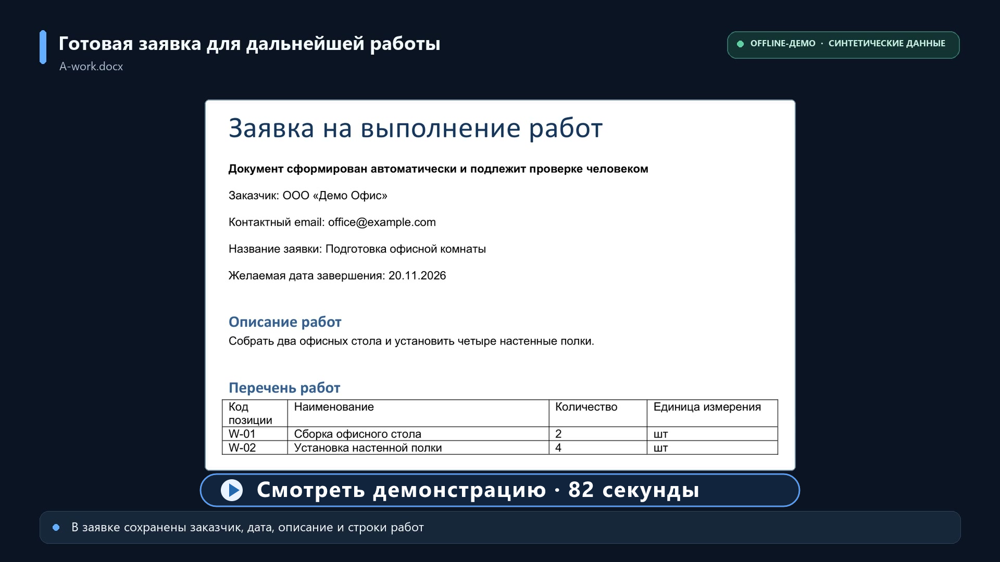
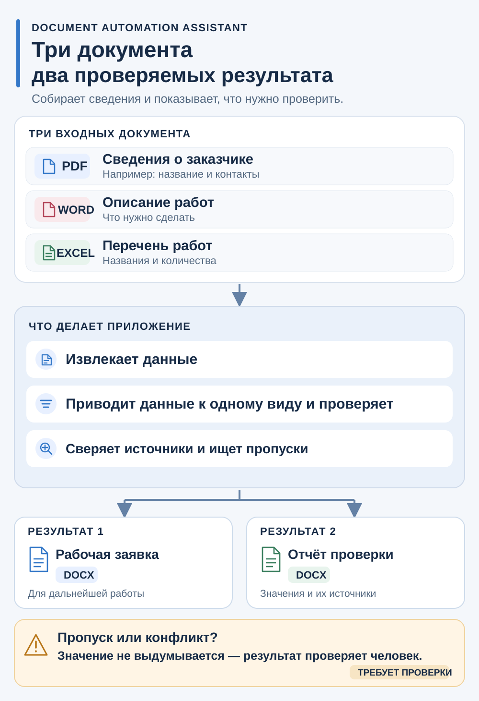
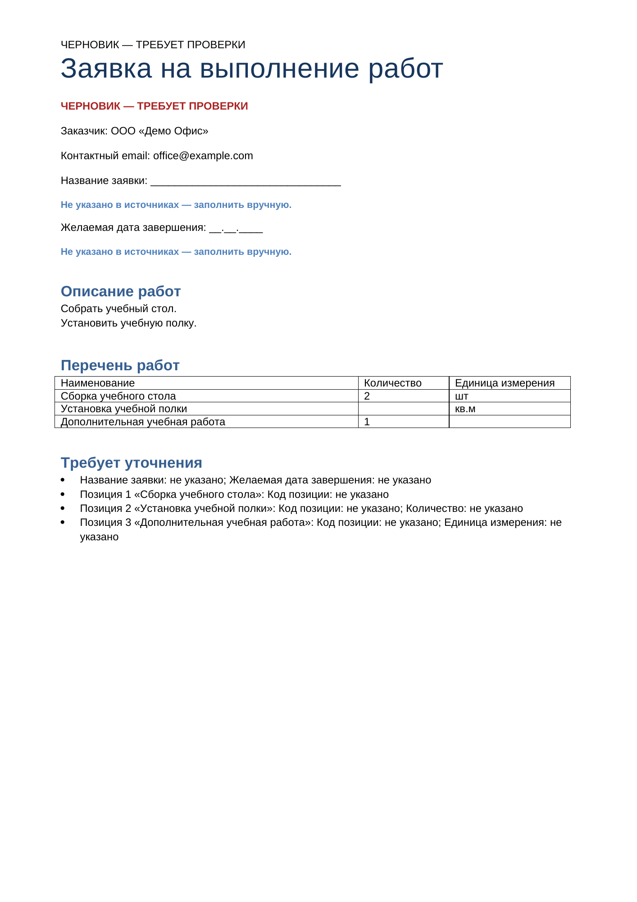
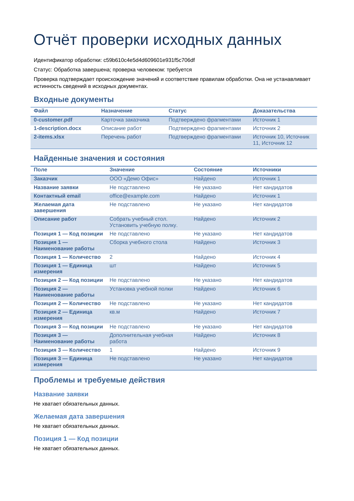

# Document Automation Assistant 2.0

**Статус: версия 2.0.0 опубликована в GitHub.**

Пройдены 699 автоматизированных тестов, проверены Docker и основные сценарии Streamlit. Аудит зависимостей не выявил известных уязвимостей в проверенном окружении. Подробности и ограничения — в [отчёте по безопасности зависимостей](docs/DEPENDENCY_SECURITY_REVIEW.md).

**Из карточки заказчика, описания и перечня работ — рабочая заявка и отчёт проверки
в Word, с источниками значений и замечаниями для сотрудника.**

Приложение сокращает ручной перенос сведений из нескольких файлов, их сверку и
подготовку черновика. Экономия времени и точность на документах клиентов не измерялись.
Это локальный однопользовательский MVP; окончательное решение принимает человек.

## Какие документы можно загрузить

Текстовые **PDF**, **DOCX** и **XLSX**: каждая из трёх групп данных может находиться
в любом из этих форматов. Подойдут комплект из трёх Word-файлов, трёх Excel-файлов,
трёх PDF или смешанный комплект. Один файл может содержать несколько групп.
Лимиты: 1–10 файлов, до 10 MiB каждый и 30 MiB суммарно.

Поддерживаются конкретные структуры, а не любое содержимое файлов:

| Формат | Поддерживаемая структура | Ограничения |
|---|---|---|
| PDF | Подписанные текстовые поля; таблица с буквальным `|` или табуляцией | Без сканов/OCR, визуальных колонок и переносов ячеек/таблицы через страницу |
| DOCX | Подписанные абзацы и разделы, простые пары ячеек, прямоугольная таблица работ | Без объединённых/вложенных ячеек и нескольких абзацев в ячейке таблицы |
| XLSX | Подпись и значение справа, описание в одной ячейке, однозначная таблица работ | Формулы и объединения не считаются достоверными значениями |

Разрешённые подписи, единицы и поля конечны; одна однозначная таблица позиций на
документ. **Все 27 сочетаний относятся к проверенным структурам данных**, а не к
произвольным PDF, Word или Excel. [Контракт v2](docs/DEMO_CONTRACT_V2.md) ·
[Матрица и ограничения](docs/FORMATS_V2.md) · [Допустимые подписи](docs/VARIANT_B.md).

## Два результата и контроль источников

| DOCX | Содержание |
|---|---|
| Рабочая заявка | Подтверждённые поля, описание и позиции; при замечаниях — маркированный черновик и пустые места для ручной проверки |
| Отчёт проверки | Значения и состояния, пропуски/конфликты, фрагменты источников и координаты, отклонённые кандидаты и audit |

Приложение проверяет документ, координаты, исходный фрагмент и допустимый контекст.
Равные значения сохраняют все подтверждения; конфликт не разрешается выбором победителя.
Отсутствующие значения не выдумываются. Пропуски обязательных полей, неоднозначность
и обнаруженные неподдерживаемые структуры дают `needs_review`. Provenance подтверждает
происхождение значения, но не истинность сведений в исходном документе.
`completed` означает завершённую обработку, а принятие оператором — отдельное действие.

## Расходы и сбои

Доступны число LLM-попыток/повторов, подтверждённые input/output/cached tokens,
расчётная стоимость по сохранённому тарифу, неизвестные расходы и средняя API-стоимость
на принятый результат. Последняя включает неудачные и непринятые запуски; при неизвестных
расходах, разных валютах или отсутствии принятых результатов точная средняя отсутствует.
Это оценка API, не счёт провайдера и не полная стоимость труда сотрудника.

Повтор одного Idempotency-Key возвращает прежний запуск. Неопределённый исход
LLM блокирует связанный повтор; автоматического платного retry и перехода на demo нет.
Критическая ошибка чтения/адаптера блокирует оба DOCX. Повреждённый или незавершённый
DOCX не выдаётся: предусмотрено явное восстановление из сохранённого результата.
Есть offline backup → verify → restore в новый каталог, без замены рабочих данных.

[Расходы](docs/COST_METRICS.md) · [Принятие и метрики](docs/BUSINESS_METRICS.md) ·
[Повторы](docs/SAFE_RETRIES_AND_IDEMPOTENCY.md) · [Восстановление DOCX](docs/ARTIFACT_RECOVERY.md) ·
[Резервные копии](docs/BACKUP_AND_RECOVERY.md).

## Быстрый запуск offline demo

Нужен Python 3.12. Выполняйте команды из корня checkout.
Установка требует интернета; после неё offline demo работает без API-ключей и LLM.

```powershell
python -m venv .venv
.\.venv\Scripts\python.exe -m pip --disable-pip-version-check install pip==26.2
.\.venv\Scripts\python.exe -m pip --disable-pip-version-check install -c constraints-py312.txt -e ".[test]"
$env:DAA_MODE = 'demo'
$env:DAA_ALLOW_PAID = 'false'
.\.venv\Scripts\python.exe -B scripts/demo_formats.py --cases PPP DDD XXX DXD XPX --output tmp/my-offline-demo
```

Команда создаёт десять проверяемых DOCX для пяти синтетических комплектов.
Результаты — `tmp/my-offline-demo/<run_id>/`. Для нового независимого прогона
используйте другой каталог. Для интерфейса:

```powershell
$env:DAA_MODE = 'demo'
$env:DAA_ALLOW_PAID = 'false'
.\.venv\Scripts\python.exe -m uvicorn document_automation.api:create_app --factory --host 127.0.0.1 --port 8000
```

Во втором терминале:

```powershell
$env:DAA_API_URL = 'http://127.0.0.1:8000'
.\.venv\Scripts\python.exe -m streamlit run src/document_automation/ui.py --server.address 127.0.0.1 --server.port 8501 --browser.gatherUsageStats false
```

Откройте http://127.0.0.1:8501. A — полный комплект, B — пропуск даты,
C — конфликт, V — вариативные заголовки и частичные позиции.
Для одинаковых форматов загрузите `customer`, `description`, `items` с одним
расширением из `tests/fixtures/formats/`. Сформируйте и скачайте оба DOCX.
Остановка — Ctrl+C в обоих терминалах; данные сохраняются локально в `data/`.

На Linux/macOS используйте `.venv/bin/python` и `export` для переменных окружения.

## Три разных режима

| Режим | Что происходит | Как понимать расходы |
|---|---|---|
| Offline demo | Детерминированные правила, синтетические входы, внешних LLM-вызовов нет | Ноль только по LLM API; труд и инфраструктура не измеряются |
| Mock LLM | Тестовый HTTP transport имитирует ответы, токены и сбои | Условные тарифы и синтетические суммы; это не затраты клиента |
| Реальный API | Требует отдельной явной конфигурации и разрешения оплаты | Usage и настроенный тариф дают оценку; списание подтверждает провайдер |

Реальная LLM на новых структурах v2 не проверена. Исторические ограниченные опыты
прежнего маршрута описаны в [PROXYAPI.md](docs/PROXYAPI.md); они не доказывают
качество модели на 27 сочетаниях. Публичная поставка 2.0 проверена без платных запросов.

## Docker и подтверждённые проверки

```powershell
docker compose up --build -d
```

UI: http://127.0.0.1:18501, API: http://127.0.0.1:18000/docs.
Порты публикуются только на localhost. Backend работает как UID/GID 1000:1000;
данные — `/var/lib/daa/data`, общий lock — в `/var/lib/daa`.
`docker compose down` сохраняет volumes; не добавляйте `-v` для рабочих данных.
Для обновления прежней установки сохраните Compose project name и сначала
прочитайте [DOCKER_SMOKE.md](docs/DOCKER_SMOKE.md): права существующего volume
не исправляются автоматически.

В подготовленном публичном дереве 2.0.0 повторно прошли **699 тестов**, включая контракты v1/v2,
27 сочетаний поддерживаемых структур, оба DOCX, расходы, повторы и backup/restore.
Проверки окончательного публичного дерева и ограничения:
[PUBLICATION_DIFF_REVIEW.md](PUBLICATION_DIFF_REVIEW.md).
История подготовки: [отчёт кандидата 2.0.0rc1](docs/RELEASE_CANDIDATE_REPORT.md).

```powershell
.\.venv\Scripts\python.exe -m pytest -q -p no:cacheprovider
.\.venv\Scripts\python.exe -m ruff check src tests scripts
.\.venv\Scripts\python.exe -m ruff format --check src tests scripts
.\.venv\Scripts\python.exe scripts/check_repository.py
git diff --check
```

## Действующая демонстрация

[](https://kirilltomenko.github.io/document-automation-assistant/)

Существующий ролик (81 секунда) показывает базовый сценарий: прежний смешанный
комплект, offline, синтетические данные. Возможности версии 2.0 — одинаковые форматы,
расходы, безопасные повторы, принятие и backup/restore — этот ролик не демонстрирует.
[Предложение обновления схемы, обложки, Pages и сценария](docs/DEMO_V2_PROPOSAL.md).



| Рабочая заявка V | Отчёт проверки V |
|---|---|
|  |  |

[Происхождение иллюстраций](docs/images/README.md).

## Устройство и границы

Streamlit → FastAPI → парсеры → offline/LLM adapter → детерминированная проверка
→ Pydantic-результат → два DOCX, SQLite и audit.
Провайдер отделён от бизнес-правил. [Архитектура](docs/DECISIONS.md) ·
[API](docs/API.md) · [Хранение](docs/STORAGE.md) · [Контракт v1](docs/DEMO_CONTRACT.md).

Один локальный backend, без авторизации. Не открывайте API/UI в интернет.
Нет OCR, произвольных шаблонов, интеграций с учётными системами, редактора данных
и нескольких workers. Рабочие документы и резервные копии требуют ограничения доступа;
шифрование и автоматическое удаление не реализованы. Сохранность при любом аппаратном
отказе не гарантируется. Старые snapshots v1 читаются без изменения fingerprints;
исправления извлечения применяются только к новым обработкам.

Лицензия [MIT](LICENSE). Copyright © 2026 Kirill Tomenko.
