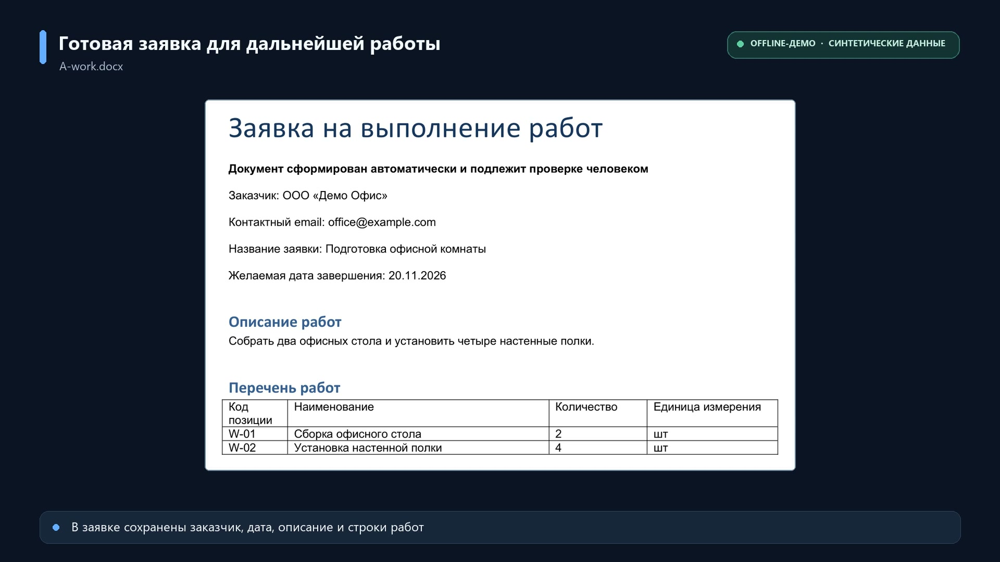
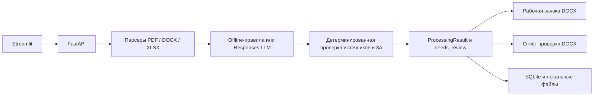

# Document Automation Assistant

Локальный portfolio MVP для AI Automation Developer: подготовка заявки на выполнение
работ из разнородных документов с проверяемыми источниками и участием человека.

## Бизнес-проблема

Сотрудник получает сведения о заказчике и работах в нескольких файлах, вручную
переносит их в Word, ищет пропуски и сверяет противоречия. Система собирает
поддерживаемые данные, показывает проблемы и готовит документы для проверки.
Экономия времени не измерялась; проект демонстрирует работающий процесс автоматизации.

## Демонстрация

[](docs/video/document-automation-assistant-demo.mp4)

Видео, 81 секунда: из **PDF, DOCX и XLSX** формируются рабочая заявка и отдельный
отчёт проверки. Значения связаны с источниками и координатами; пропуски и неоднозначности отмечаются
как `needs_review`. Это **offline demo на синтетических документах, без LLM-вызовов**.

## Входные файлы и результат

Пользователь загружает текстовый **PDF** с карточкой заказчика, **DOCX** с описанием
работ и **XLSX** с перечнем позиций. Встроенные комплекты полностью синтетические.

Один запуск создаёт два независимых файла без повторного извлечения:

| Документ | Для чего нужен |
|---|---|
| Рабочая заявка | Подтверждённые данные, описание и таблица работ, краткие замечания, поля для ручного заполнения; при проблемах — заметная маркировка черновика |
| Отчёт проверки | Значения и состояния, пропуски и конфликты, источники и координаты, отклонённые кандидаты, отдельный технический audit |

Снимки реальных DOCX, сформированных offline на синтетическом комплекте V:

| Рабочая заявка — страница 1 | Отчёт проверки — страница 1 |
|---|---|
|  |  |

[Происхождение изображений](docs/images/README.md) · [Сценарий демо на 60–90 секунд](docs/DEMO.md)

## Контроль данных

LLM предлагает классификации и кандидатов значений. Приложение самостоятельно
проверяет принадлежность источника запуску, координаты, исходный фрагмент и
допустимый контекст. Только приложение определяет состояния полей, `needs_review`
и разрешение генерации/экспорта. Пропуски не заполняются догадками, конфликтующие
значения не выбираются автоматически.

Provenance подтверждает **происхождение значения и соответствие правилам обработки**,
но не истинность информации в исходном документе. `completed` не означает утверждение
заявки: итог проверяет человек. Практически пустая заявка запрещена; технический
отказ блокирует оба DOCX. Подробнее: [бизнес-контракт](docs/DEMO_CONTRACT.md).

## Архитектура



Python 3.12, Pydantic, pypdf, python-docx, openpyxl, FastAPI, Streamlit, SQLite.
Провайдер отделён от бизнес-логики; генерация использует один результат и `run_id`.
Offline-режим извлекает данные из файлов по поддерживаемым правилам, не вызывает LLM.

[Архитектурные решения](docs/DECISIONS.md) · [Извлечение](docs/EXTRACTION.md) ·
[Генерация](docs/GENERATION.md) · [API](docs/API.md) · [Хранение](docs/STORAGE.md)

## Быстрый запуск offline demo

Нужны Python 3.12 и checkout репозитория. Установка зависимостей требует интернета;
сама демонстрация после установки работает без LLM, API-ключей и оплаты.
Команды выполняются из корня проекта.

### Python — PowerShell

```powershell
python -m venv .venv
.\.venv\Scripts\python.exe -m pip install -e ".[test]"
$env:DAA_MODE = 'demo'
$env:DAA_ALLOW_PAID = 'false'
.\.venv\Scripts\python.exe -m uvicorn document_automation.api:create_app --factory --host 127.0.0.1 --port 8000
```

Во втором терминале:

```powershell
$env:DAA_API_URL = 'http://127.0.0.1:8000'
.\.venv\Scripts\python.exe -m streamlit run src/document_automation/ui.py --server.address 127.0.0.1 --server.port 8501 --browser.gatherUsageStats false
```

Откройте http://127.0.0.1:8501, выберите A, нажмите «Обработать» и скачайте оба
документа. B показывает отсутствие даты, C — конфликт, V — вариативные заголовки
и частичные позиции. Остановка — Ctrl+C в обоих терминалах.

На Linux/macOS: создайте venv, выполните `source .venv/bin/activate`, используйте
`python` вместо `.\.venv\Scripts\python.exe`, а переменные задавайте через
`export DAA_MODE=demo`, `export DAA_ALLOW_PAID=false`, `export DAA_API_URL=http://127.0.0.1:8000`.

### Docker Compose

```sh
docker compose up --build -d
```

| Вариант запуска | UI | API / документация |
|---|---|---|
| Python | http://127.0.0.1:8501 | http://127.0.0.1:8000/docs |
| Docker | http://127.0.0.1:18501 | http://127.0.0.1:18000/docs |

Docker публикует порты только на localhost. `docker compose down` останавливает
сервисы, сохраняя volume `workflow-data`. Порты задаются `DAA_UI_PORT` / `DAA_API_PORT`.

Проверка работающего Python-запуска из третьего PowerShell-терминала:

```powershell
$env:DAA_API_URL = 'http://127.0.0.1:8000'
$env:DAA_UI_URL = 'http://127.0.0.1:8501'
.\.venv\Scripts\python.exe scripts/smoke_demo.py
```

Для Docker задайте соответственно `18000` и `18501` — это также стандартные порты
smoke-скрипта. Скрипт проверяет demo-режим до обработки, запускает A/B/C/V/T и
сохраняет локальные DOCX в игнорируемый `tmp/demo-output`.

## Подтверждённые проверки

| Режим | Что подтверждено | Чего это не доказывает |
|---|---|---|
| Offline | A: completed, review=false; B/C/V: completed, review=true; два DOCX. T: failed, оба документа запрещены | Качество модели на произвольных документах |
| Mock Responses | Строгая схема, ограничения, ошибки, row_scope, безопасная диагностика, запрет DOCX при отказе | Работу реального сервиса LLM |
| Реальный ProxyAPI A | Успешный синтетический A, совпадение с бизнес-эталоном, review=false, два DOCX | Обобщённую точность LLM |
| Реальный ProxyAPI V | Отказ Extraction: candidates.4 / row_scope; до provenance/3A, без DOCX | Успешную обработку V моделью |

Прямой OpenAI API не проверен. После отказа V инструкции `row` уточнены и проверены
локально; нового реального запроса не было. Модель экспериментов —
`openai/gpt-4.1-mini`. [Подробности и ограничения ProxyAPI](docs/PROXYAPI.md).

Последняя полная регрессия: **394 теста**. Покрыты парсеры, источники, нормализация,
конфликты, операции, два DOCX, API, Streamlit AppTest и SQLite. AppTest не заменяет
ручную проверку браузера. Изображения DOCX проверены через рендер LibreOffice;
это не гарантия идентичной вёрстки во всех версиях Word.

```sh
python -m pytest -q -p no:cacheprovider
python -m ruff check src tests scripts
python -m ruff format --check src tests scripts
python scripts/check_repository.py
git diff --check
```

Команды выполняются Python из установленного venv; в PowerShell можно использовать
полный путь `.\.venv\Scripts\python.exe`. Workflow CI настроен на pytest и Ruff без
секретов и LLM; первый запуск на GitHub ещё предстоит.

## Ограничения и безопасность

- **Локальный однопользовательский MVP, без авторизации. Открытое размещение сервиса
  без дополнительной защиты запрещено.** Не публикуйте порты в интернет.
- Поддерживаются утверждённые поля и структуры. Нет OCR, произвольных шаблонов,
  финансовых расчётов, интеграций с учётными системами или внешних действий.
- Один backend worker. Исходники и результаты сохраняются локально; шифрование
  хранилища и автоматическая политика удаления не реализованы.
- В публичных примерах используются только синтетические данные. Ключи, клиентские
  документы, журналы запросов и локальные результаты обработки не входят в Git.
- Ограниченная проверка истории и текущих файлов не обнаружила проверяемых шаблонов
  секретов. Это не независимый аудит безопасности и не сканирование уязвимостей зависимостей.
- `.env` автоматически не загружается. Платный режим требует явной конфигурации;
  программный бюджет не гарантирует абсолютный потолок расходов.

Лицензия: [MIT](LICENSE). Copyright © 2026 Kirill Tomenko.
[Проверки подготовки и ручные шаги перед публикацией](docs/PUBLICATION.md).
